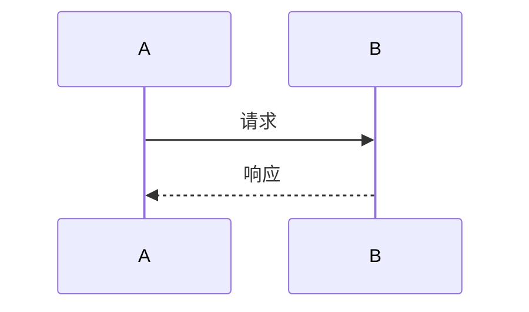

<CategoryTag name="资源" link="/library/resources/" />

技术人要画图：架构图、流程图、时序图、脑图。工具一堆，
按「图的类型」选才不迷路。这份按场景分类，都是自用或深用过。

## 一、手绘风：Excalidraw

[excalidraw.com](https://excalidraw.com) —— 开源免费，
手绘风格，**本站全部配图的手绘参考**。

**适合**：架构草图、示意图、讲概念的图。
**优点**：快（几分钟出图）、好看（不严肃但清晰）、
支持中文字体（配好字体栈）、可导出 SVG/PNG、
有 VS Code 插件（[Excalidraw 插件](https://marketplace.visualstudio.com/items?itemName=pomdtr.excalidraw-editor)）。
**缺点**：复杂精细的图别用它（手绘风限制了精度）。

## 二、标准图表：draw.io / diagrams.net

[diagrams.net](https://app.diagrams.net) —— 免费开源无广告，
技术圈事实标准。

**适合**：正式架构图、网络拓扑、ER 图、UML。
**优点**：图形库全（AWS/Azure/网络/流程图符号）、
精度控制强、能存本地/OneDrive/GitHub、免费。
**缺点**：默认审美「商务风」，要好看得自己调。

## 三、代码画图：Mermaid + PlantUML

**Mermaid**：Markdown 里画图（[本站有教程](../markdown-table-diagram.md)）：

````markdown

````

**PlantUML**：老牌，UML 全支持，语法更严谨。

**适合**：写文档时要「图随文走」—— 改代码改文档，
图是文本，git 能 diff。
**优点**：版本友好、写起来快、不用切工具。
**缺点**：布局不可控（自动布局经常「意想不到」）、
复杂图调起来想砸键盘。

**选型**：文档内嵌用 Mermaid；要精确控制用 draw.io/Excalidraw。

## 四、脑图：XMind / 幕布

- **XMind**：功能全，付费（有免费版），导出格式多；
- **幕布**：大纲笔记转脑图，国内快，免费档够用；
- **MarkMind**（VS Code 插件）/ **mdnice 脑图**：
  程序员友好，Markdown 大纲直接转。

**适合**：梳理知识结构、读书笔记、会议纪要。
**注意**：脑图是「思考工具」不是「展示工具」 ——
给别人看的图，别直接甩脑图（信息密度太高）。

## 五、白板协作：ProcessOn / boardmix

- **ProcessOn**：国内访问快，模板多（流程图/架构图），
  免费档有限制；
- **boardmix / 亿图图示**：国产全能，类似 draw.io + 白板；
- **Miro / FigJam**：国际大牌，团队远程协作强（国内访问看缘分）。

**适合**：团队远程评审、头脑风暴。
**个人用**：draw.io 免费无限制，不折腾。

## 六、设计向：Figma

[figma.com](https://figma.com) —— UI 设计标准工具。

程序员用的场景：

- **看设计稿**（标注、间距、色值直接抄）；
- **画高保真原型**（比 Axure 轻）；
- **免费档**：个人 3 个文件，够用。

**不是画架构图的首选**（太重），但「前端 + 设计协作」
必备。国产替代：即时设计、MasterGo（访问快）。

## 七、本站的选型心路

技术客栈的配图路线：**Excalidraw 风格 + 手写 SVG**。

为什么不用 Mermaid：布局不可控，中文渲染看运气。
为什么不用 draw.io：商务风重，和站点气质不符。
为什么手写 SVG：完全可控（颜色/字体/布局）、
体积极小（几 KB）、无损缩放、CSS 能改色。

代价：**画得慢**（一张图半小时起）。所以本站配图少而精 ——
不值得为配图配图，图是文章的服务员。

## 八、按场景速查

| 要画 | 用啥 |
| --- | --- |
| 概念草图/架构示意 | Excalidraw |
| 正式架构图/网络图 | draw.io |
| 文档内嵌流程图 | Mermaid |
| UML/复杂建模 | PlantUML / StarUML |
| 知识梳理/读书笔记 | XMind / 幕布 |
| 团队远程白板 | ProcessOn / Miro |
| UI 稿/原型 | Figma / 即时设计 |
| 「要好看且可控」 | 手写 SVG（本站路线） |

## 小结

画图工具的真相：**没有神器，只有「当前场景顺手」**。
记住本站的教训 —— 别沉迷工具评测，
选一个（Excalidraw + Mermaid 覆盖八成），把时间留给图里
的内容。图是讲道理的道具，道具再好，道理不通也白搭。
