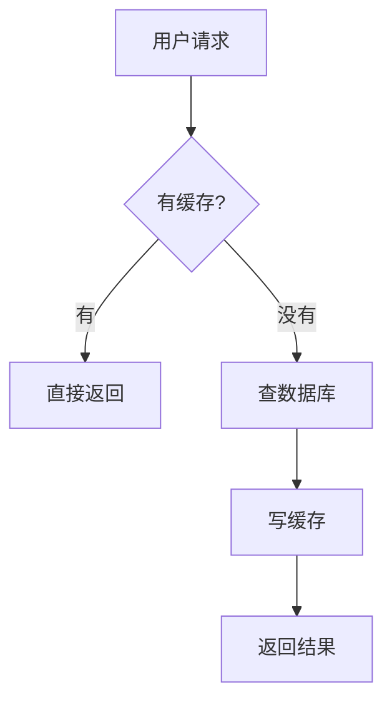
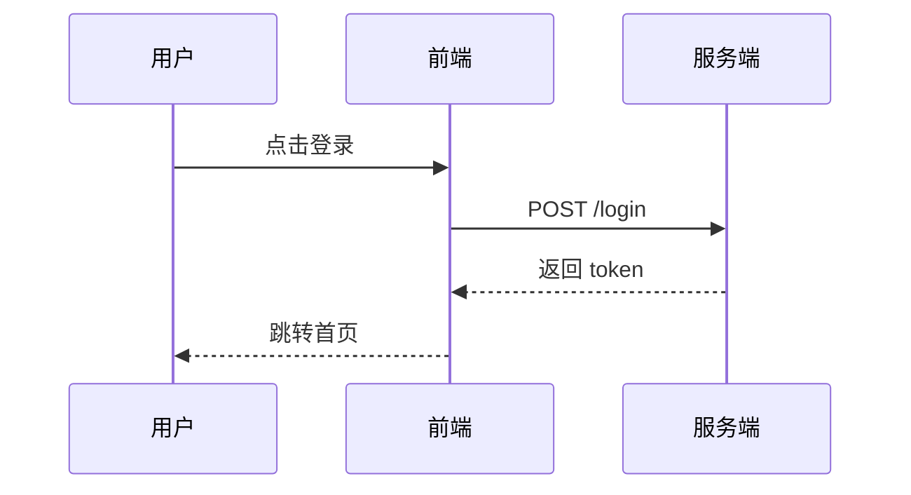
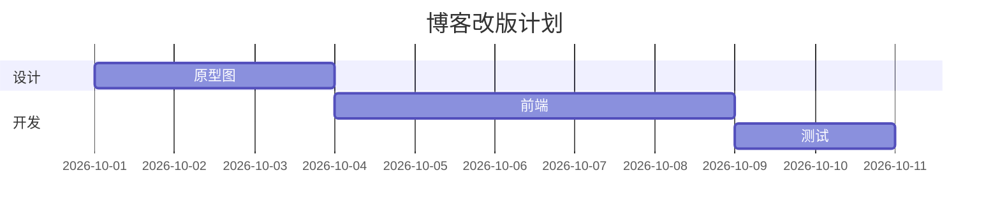
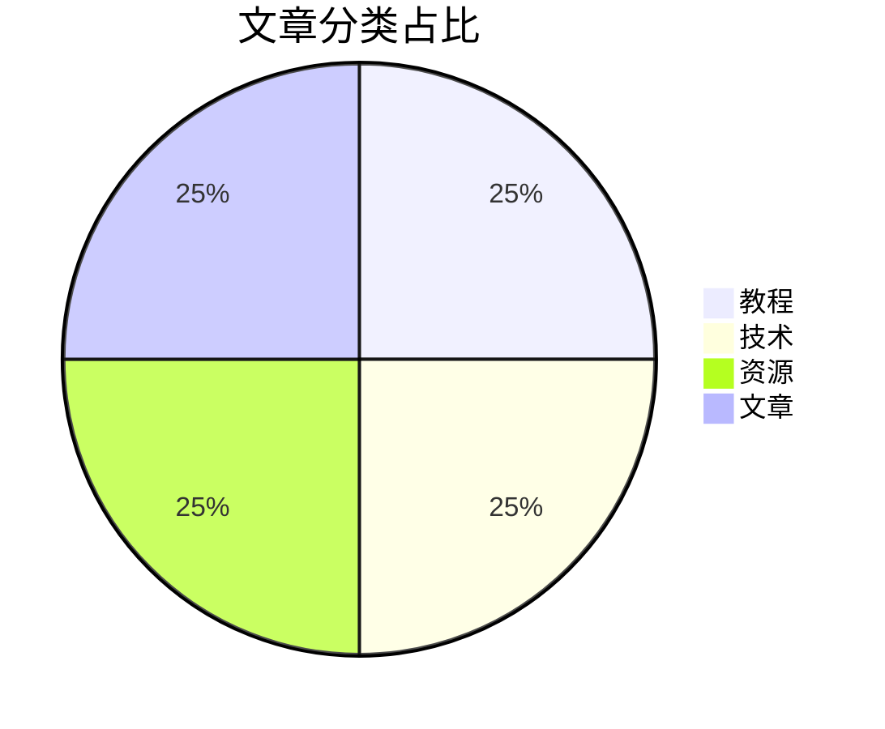

# Markdown 表格与 Mermaid 图

[Markdown 写作指南](./markdown-guide.md) 讲基础语法，
这篇讲两个「文档颜值担当」：**表格**和**Mermaid 图**。
技术文档里，一张清晰的表胜过三段话，一张流程图胜过五段话。

## 一、表格：从能看到好看

### 基本语法

```markdown
| 命令 | 作用 | 风险 |
| --- | --- | --- |
| git reset --soft | 退提交留改动 | 低 |
| git reset --hard | 退提交删改动 | 高 |
```

渲染出来：

| 命令 | 作用 | 风险 |
| --- | --- | --- |
| git reset --soft | 退提交留改动 | 低 |
| git reset --hard | 退提交删改动 | 高 |

### 对齐：第二行的冒号

```markdown
| 左对齐 | 居中 | 右对齐 |
| :--- | :---: | ---: |
| 文字 | 文字 | 100 |
```

数字列右对齐（`:--`），短文本列居中，其余左对齐 ——
一眼扫过去最舒服。

### 三个排版技巧

**1. 列宽不用手动对齐**。渲染器不看你源代码对齐没对齐，
但**你自己**看 —— 用编辑器插件（VS Code 的 Markdown All in One）
一键格式化表格，源码也好看。

**2. 长内容用 `<br>`**。单元格里换行：

```markdown
| 阶段 | 内容 |
| --- | --- |
| 准备 | 列清单<br>约评审 |
```

**3. 竖线要转义**。内容里有 `|`，写成 `\|`，
或用实体 `&#124;`（代码块里的正则表达式特多这个）。

### 表格什么时候不该用

- **内容长短不一**（有的单元格一行，有的十行）→ 用列表；
- **需要复杂层级** → 用标题分节；
- **超过六列** → 考虑拆表或换呈现（宽表格手机上没法看）。

## 二、Mermaid：文本画图

Mermaid 让你**用代码画图** —— 流程图、时序图、甘特图、类图。
改图就是改文字，git 能 diff，Review 能审。

````markdown

````

渲染效果（本站文章里的配图思路同源，只不过我们是 SVG）：


（如果你的 Markdown 渲染器不支持，会显示代码块 —— 
Plume 主题需确认支持，见下文。）

### 四种最常用图

**1. 流程图（flowchart）**


方向：`TD`（上到下）、`LR`（左到右）、`BT`、`RL`。
虚线 `-.->` 表示异常路径。

**2. 时序图（sequence）**：交互场景神器



**3. 甘特图（gantt）**：项目排期



**4. 饼图/柱状图（pie/xy-chart）**：简单数据可视化



### 常用语法备忘

```text
节点形状：
  A[矩形]  B(圆角)  C{菱形}  D((圆形))  E>旗帜]

线条：
  -->   实线箭头
  ---   实线无箭头
  -.->  虚线箭头
  ==>  粗线箭头

注释/分组：
  subgraph 标题 … end
```

## 三、在本站（Plume）用 Mermaid

Plume 1.x 支持图表渲染，启用方式（`config.ts`）：

```ts
theme: plumeTheme({
  markdown: {
    chart: true,       // 图表（mermaid）
  },
})
```

（具体以你使用的 Plume 版本为准 —— 不支持的话，
图可以用 [Excalidraw](https://excalidraw.com) 画好贴 SVG，
本站目前就是全 SVG 路线。）

**本站为什么用 SVG 不用 Mermaid**：
完全可控（样式统一）、不依赖渲染器、SVG 能精细调。
缺点是要手画 —— 所以本站配图少而精，Mermaid 适合
「快速表达逻辑」的场景，两者互补。

## 四、画图的原则

1. **能表则表，能图则图**：对比数据用表格，流程逻辑用图；
2. **一张图只说一件事**：流程 + 时序塞一张，没人看得懂；
3. **配色克制**：两三种颜色够，重点标红，其余灰；
4. **文字比箭头重要**：节点文字说人话，别写 `processData2`；
5. **图要有 caption**：图下面一行斜体说明，讲「这张图让你看什么」。

## 小结

表格和 Mermaid 是技术文档的「硬装备」：**表格呈现对比，
Mermaid 呈现逻辑**。两个都上手快（半小时），
回报是文档可读性的质变。写文档时多问自己一句：
「这段如果画成表/图，会不会更清楚？」 ——
多半会。
